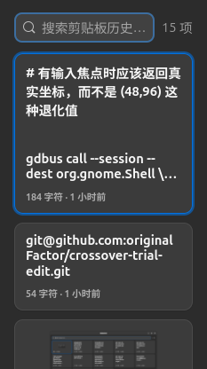

# clipcat-winui

给 [clipcat](https://github.com/xrelkd/clipcat) 加一个 Windows `Win+V` 风格的剪贴板历史面板。

GNOME 上 clipcat 自带的菜单是基于 rofi 的纯文本列表；这个项目把它换成一个
卡片网格，跟随鼠标位置弹出，失去焦点自动关闭。



## 功能

- `Super+V` 开关面板，卡片网格布局，图片显示缩略图
- 窗口开在鼠标指针旁（类似右键菜单），空间不够时自动翻转
- 失去焦点自动关闭；`Esc` 也关闭（搜索框有内容时先清空）
- 方向键移动、`Enter` 粘贴、`Delete` 删除、`/` 聚焦搜索
- 窗口尺寸记忆（存在 `$XDG_STATE_HOME/clipcat-winui/window.json`）

## 依赖

```sh
# clipcat 本体（从 release 下载 musl 静态版即可）
# https://github.com/xrelkd/clipcat/releases
# 解压后把 clipcatd / clipcatctl 放进 ~/.local/bin

sudo apt install python3-gi gir1.2-gtk-4.0 gir1.2-adw-1 xdotool x11-utils
```

## 安装

```sh
./install.sh
```

### 1. 安装扩展管理器

面板的指针定位依赖一个 GNOME Shell 扩展，而**启用扩展需要图形界面的扩展管理器**
（`gnome-extensions enable` 命令在扩展还没被 Shell 认可时经常静默失败）：

```sh
sudo apt install gnome-shell-extension-manager
```

装完在应用列表里叫 **Extension Manager**，命令行是 `extension-manager`。

### 2. 注销并重新登录

GNOME Shell 有 ESM 模块缓存，`gnome-extensions disable/enable` 和
`gnome-extensions reset` **都不会**重新读取 `extension.js`，只有重新登录才会加载。

Wayland 会话下也没有 `Alt+F2` → `r` 这种重启方式，只能注销再登录。

### 3. 在 Extension Manager 里手动启用

重新登录后打开 **Extension Manager**，在 **Installed**（已安装）里找到
**Caret Locator**，把开关打开。

> 这一步不能省。`install.sh` 里的 `gnome-extensions enable` 只是尽力而为——
> 首次安装时 Shell 还没扫描到这个新扩展，命令往往无效，但不会报错。

启用后可以这样确认它真的在跑：

```sh
gdbus call --session --dest org.gnome.Shell \
  --object-path /io/github/clipcat/CaretLocator \
  --method io.github.clipcat.CaretLocator.GetDebug
```

有返回（形如 `updates=… pointer=(x,y) …`）就说明扩展已加载。
如果报 `UnknownMethod` 或 `NameHasNoOwner`，说明扩展没启用。

### 4. 绑定快捷键

**设置 → 键盘 → 自定义快捷键**，把 `Super+V` 绑到 `~/.local/bin/clipcat-winui`。

> 注意：GNOME 默认把 `<Super>v` 分配给了 `toggle-message-tray`。
> 先让它让位，否则自定义快捷键会静默失效：
>
> ```sh
> gsettings set org.gnome.shell.keybindings toggle-message-tray "['<Super>m']"
> ```

卸载：`./install.sh --uninstall`

## 为什么必须跑在 Xwayland 上

这是整个项目最不直观的一点，也是几处实现细节的根源。

**Wayland 不允许应用给自己定位。** 没有任何客户端 API 能设置顶层窗口坐标。
要"开在鼠标旁边"，只能走 Xwayland —— 用 `GDK_BACKEND=x11` 启动，
之后才能用 `xdotool windowmove` 控制位置。

代价是下面这些坑，都已在代码里处理：

### 定位

`xdotool windowmove` 的目标坐标在 X 轴上就是内容区坐标，但 **Y 轴会被 mutter
按标题栏高度整体下移 37px**（实测：target 100 → content 137，target 300 → 337）。
所以有 `FRAME_OFFSET_Y = 37`。

这个值只能实测得到，光看"框架比内容高 62px"去推算会算错方向。

### 焦点

去掉窗口装饰（`set_decorated(False)`）后，mutter 不再把这个窗口当受管窗口，
`notify::is-active` 等焦点通知全部失效，"失焦自动关闭"随之失灵。

试过但**都不可行**的替代方案：

| 方案 | 结果 |
|---|---|
| `_NET_ACTIVE_WINDOW` | 只返回 mutter 的 guard window，看不到 Xwayland 窗口 |
| `EventControllerFocus` | 只跟踪窗口内控件焦点，`leave` 从不触发 |
| `GdkSurface` 的 `state` | 无变化通知 |
| `EventControllerLegacy` | event 参数为 `null` |
| `IBusManager` 的 `set-cursor-location` | 本机 `org.freedesktop.IBus.Panel` 无持有者，外部应用打字时不触发 |

**结论：保留系统边框。** 有边框时窗口由 mutter 正常管理，焦点事件正常。

### 文本光标拿不到

原本想定位到文本插入符（像输入法候选窗）。这条路在本机走不通：
IBus panel 服务名无人持有，`set-cursor-location` 只在面板自己获得焦点时
产生数据（会形成"把面板挪到自己下面"的自指循环）。AT-SPI 的
`get_range_extents` 返回 `Unsupported coordinate space`。

所以最终用的是**鼠标指针位置**（`global.get_pointer()`），
它由 GNOME Shell 扩展通过 D-Bus 暴露，始终准确。

## 结构

```
panel/clipcat-winui.py    GTK4/Adw 面板（约 1100 行）
extension/                GNOME Shell 扩展，通过 D-Bus 提供指针坐标
bin/clipcat-winui         启动器（设 GDK_BACKEND=x11）
config/                   clipcatd / clipcat-menu 配置、systemd 单元模板
tools/xwd2png.py          XWD → PNG 转换器（本环境 grim 不可用）
install.sh                安装 / 卸载
```

要改这个项目的代码，先读 [AGENTS.md](AGENTS.md)——里面记了不能违反的平台约束
和验证方法。

面板通过 clipcat 的 D-Bus 接口读写历史：

- 路径 `/org/clipcat/clipcat/manager`，接口 `org.clipcat.clipcat.Manager`
- `List(t) -> a(tsuxs)`、`Get(t) -> (tayusx)`、`Mark(tu) -> b`、`Remove(t) -> b`
- 元组顺序是 **id, data, kind, mime, timestamp**，`kind` 表示"上次标记的选择"，
  不是固定属性，不要拿它做过滤

## 环境

开发并验证于：

- Ubuntu 26.04, kernel 7.0
- GNOME Shell 50.1, mutter 18
- Wayland 会话 + Xwayland
- 双显示器 2720×1024（副屏在右）

其它 GNOME 版本未必一样，尤其是上面那些"实测"出来的偏移量和焦点行为。
